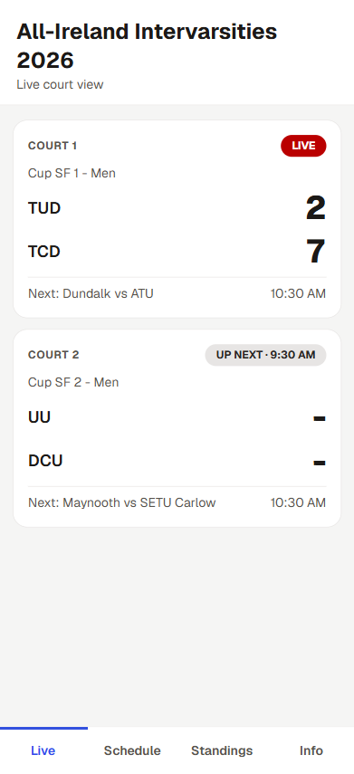
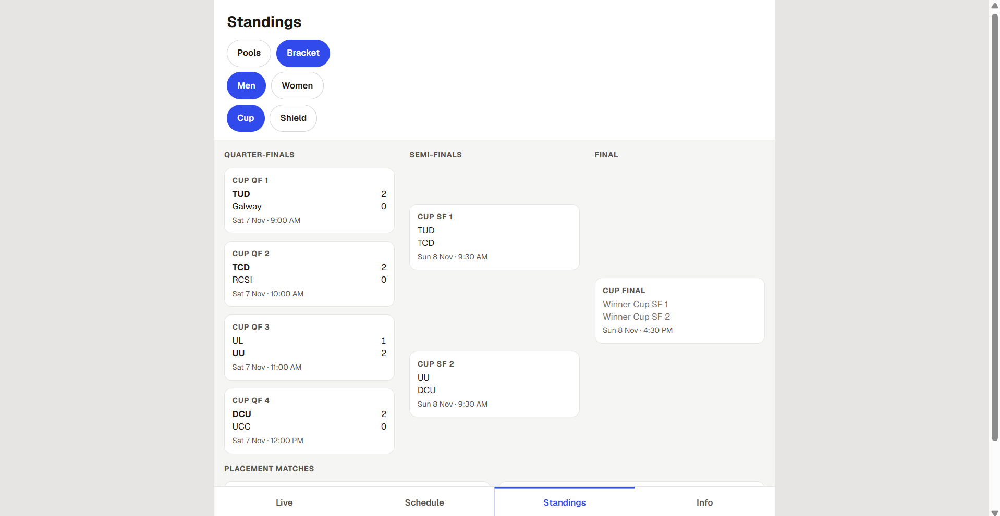
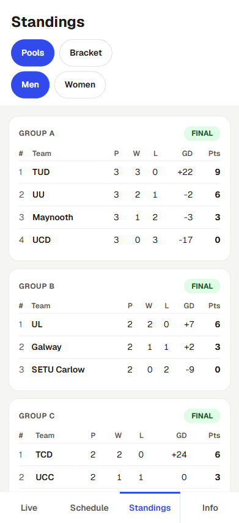
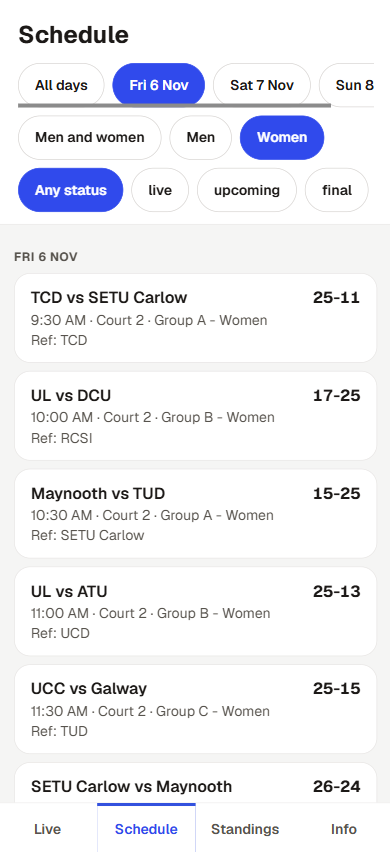
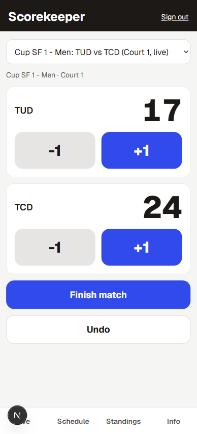

# Court View

A mobile-first live scoring site for a volleyball tournament. It shows what is happening on each court right now, with live scores, the schedule, pool standings, and a knockout bracket that fills itself in as results come in.

I built this as a learning project around an event I know well: Intervarsity TCD 2026 (Trinity College Dublin, 6 to 8 November 2026, 24 teams, 2 courts).

**Live site:** https://court-view-murex.vercel.app



## Features

- **Live:** one card per court with the current match, the live score, and the next match. Scores update for every viewer without a refresh.
- **Schedule:** filter by day, men or women, and status, with the referee shown for each match.
- **Standings:** pool tables ranked by points, goal difference, then head-to-head, and a Cup and Shield bracket. Bracket slots such as "Group A 1st" or "Winner Cup QF 1" turn into real team names automatically once a pool finishes or a match ends.
- **Scorekeeper (staff only):** big +1 and -1 buttons, start and finish match, and undo.
- **Info:** venue and floor guide, key times, format, raffle, and contact details.
- **Standings:** pool tables ranked by points, point difference, then head-to-head, and a Cup and Shield bracket. Bracket slots such as "Group A 1st" or "Winner Cup QF 1" turn into real team names automatically once a pool finishes or a match ends.









## How it works

- **Next.js (App Router), TypeScript, and Tailwind CSS**, deployed on Vercel.
- **Supabase** provides the Postgres database, authentication, and Realtime. The site subscribes to changes on the matches table and refreshes the data when a score changes.
- **Permissions are enforced in the database.** Row-level security lets anyone read, but only signed-in staff can update matches. Sign-ups are disabled, and staff accounts are created by hand. Hiding the buttons in the UI is not the protection.
- **Standings logic** (`lib/standings.ts`) is plain TypeScript. It ranks each pool, breaks ties with head-to-head results (re-applied to whichever teams are still level), and resolves knockout labels into teams from the standings and earlier results. Nothing derived is stored, so undoing a score updates the bracket automatically.

## Data model

`courts`, `teams` (division and pool), `matches` (court, teams or placeholder labels, date, time, scores, status, stage, referee), and `staff` (user and role).

## Run it locally

```bash
npm install
```

Create `.env.local` with your own Supabase project:

```
NEXT_PUBLIC_SUPABASE_URL=your-project-url
NEXT_PUBLIC_SUPABASE_PUBLISHABLE_KEY=your-publishable-key
```

Then:

```bash
npm run dev
```

## Tests

npm test

Unit tests (Vitest) cover the standings and bracket logic: ranking by points, head-to-head between two teams, three-way cycles with different and identical margins, partial splits where head-to-head has to be re-applied, and bracket labels resolving, un-resolving after an undone score, and feeding later rounds.

## What I would add next

Admin screens to edit teams and the schedule inside the app, and embedded stream players for each court.

## Notes

Friday and Saturday start times are estimated, because the published schedule gave the order of matches and not the times. Sunday times are as published.
